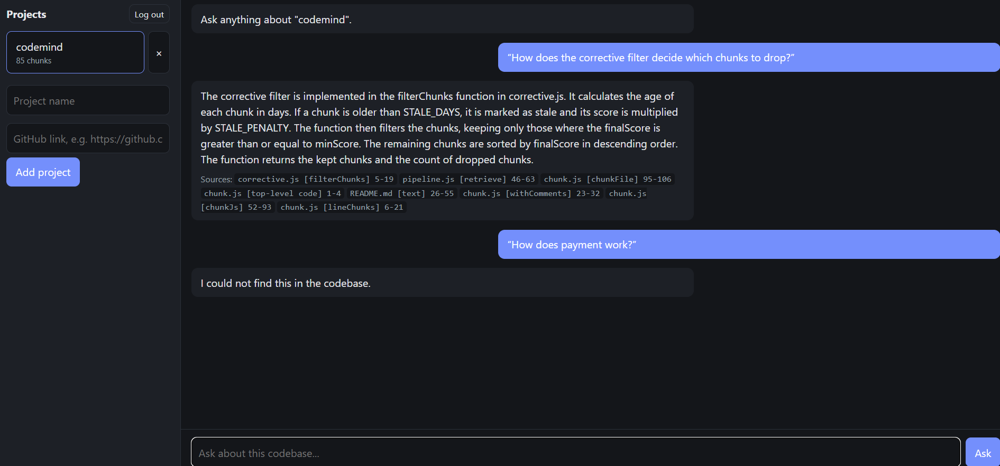

# CodeMind

Ask questions about a codebase in plain English and get answers that **cite the exact file, function and line range**. If the codebase doesn't contain the answer, CodeMind says so instead of guessing.

Built from scratch (no LangChain / LlamaIndex) to understand every stage of a RAG system: chunking, embeddings, hybrid retrieval, query routing, corrective filtering, caching, auth and evaluation.


**Live demo:** https://codemind-9fu8.onrender.com 
*(Hosted on a free tier: if nobody has used it for 15 minutes it goes to sleep, so the first request can take about a minute to wake up. Sign up with any email, add a public GitHub repo, then ask about its code.)*

## How it works

```
question
   │
   ▼
Router (general / simple / complex)  ──►  general: answered without retrieval
   │                                      simple: top 3 chunks, complex: top 8
   ▼
Hybrid search (vector + keyword)
   │
   ▼
Corrective filter (drop weak matches, down-weight stale files)
   │
   ▼
LLM answer grounded only in the kept chunks  ──►  answer + citations
   (no chunks left? → "the codebase doesn't cover this")
```

**RAG variant:** Adaptive RAG (routing) + Corrective RAG (filtering) on top of hybrid retrieval.

| Stage | What it does |
|---|---|
| Chunking | Parses JS with `acorn` and splits at **function/class boundaries** (max 60 lines, leading comments included). Falls back to line-based chunks when a file can't be parsed. Markdown is chunked by lines. |
| Embeddings | `all-MiniLM-L6-v2` (384 dimensions) run locally via `@huggingface/transformers`. No embedding API cost. |
| Hybrid search | `score = 0.5 · cosine similarity + 0.5 · keyword score`. Keyword score gives full credit to function-name matches and partial credit to body matches, so exact identifiers (`askLLM`, `buildIndex`) are found even when the embedding is vague. |
| Adaptive routing | An LLM classifier decides retrieval depth. A regex guard stops project/file questions from ever being classed as "general". |
| Corrective filter | Chunks below a minimum score are dropped; chunks from files untouched for 180+ days get a 0.7 score penalty. If nothing survives, the system refuses. |
| Answer generation | Groq (`llama-3.1-8b-instant`), temperature 0, with timeout and retries on 429/503. |
| Citations | Every answer returns `file`, `function name`, `startLine`–`endLine` for each source chunk. |

## Evaluation

The harness (`eval/run.js`) runs 16 answerable and 5 unanswerable questions against this repository's own code (18 files, 71 chunks).

**Retrieval (16 answerable questions)**

| Setup | Hit@1 | Hit@3 | MRR |
|---|---|---|---|
| Vector only | 56% | **94%** | 0.72 |
| Keyword only | 50% | 81% | 0.66 |
| **Hybrid (0.5 / 0.5)** | **69%** | 88% | **0.79** |

**Hybrid + corrective filter**

| Metric | Result |
|---|---|
| Correct chunk still present after filtering | 88% |
| Answerable questions wrongly refused | 6% (1 of 16) |
| Unanswerable questions correctly refused | 100% (5 of 5) |

**Reading the numbers**
- Hybrid puts the right chunk **first** more often (Hit@1 +13 points, MRR +0.07). Vector-only is slightly better at getting it somewhere in the top 3 (94% vs 88%).
- The filter does not remove correct chunks beyond what retrieval already missed (88% before and after).
- Both hybrid misses are cases where the answer is spread over several chunks or phrased very differently from the code (correct chunk at rank 5 and rank 8).

**Limits (please read)**
- Only 16 + 5 questions, written by the author, on a small repo. One question is worth ~6 percentage points, so small differences are noise.
- The 0.5 / 0.5 weights were tuned on the same question set, so the hybrid numbers are optimistic.
- Evaluated on JS and Markdown only.

Run it yourself: `node eval/run.js` (results are saved to `eval/results.json`).

## Product features

- **Auth:** signup/login with bcrypt-hashed passwords and JWTs. Login returns the same error for a wrong email or a wrong password.
- **Per-user projects:** each user only sees their own projects. Accessing someone else's project returns 404, not 403, so project IDs can't be probed.
- **Background indexing:** adding a project returns `202` immediately; the UI polls until it is `ready`. Projects stuck in `indexing` after a crash are marked `failed` on startup.
- **Add a project from a GitHub link:** paste `https://github.com/owner/repo`. The server validates the link (GitHub URLs only), runs a shallow `git clone` without a shell, removes `.git`, enforces size limits (150 `.js`/`.md` files, 3 MB), then indexes it in the background. Per-user limits: 5 projects, and at most 2 indexing jobs at once on the server.
- **Security:** clones live under a single `PROJECTS_ROOT`; for local folders, paths are resolved with `realpath` and checked against it (path traversal protection). Symlinks are skipped, and absolute server paths are never sent to the client or the LLM. Local folder names are disabled in production; only GitHub links are accepted.
- **Rate limiting and caching:** per-user rate limits; answers cached in memory (10 min TTL, 200 entries).
- **Storage:** PostgreSQL + `pgvector` (`vector(384)`) on Neon.
- **UI:** plain HTML/CSS/JS chat interface. Answers are rendered with `textContent`, never `innerHTML`, since they come from an LLM.

## API

| Method | Route | Description |
|---|---|---|
| GET | `/health` | Health check |
| POST | `/auth/signup`, `/auth/login` | Returns a JWT |
| GET | `/me` | Current user |
| POST | `/projects` | Add a project `{ name, repoUrl }` with a public GitHub link (clones and indexes in background) |
| GET | `/projects` | List your projects and their status |
| DELETE | `/projects/:id` | Delete a project |
| POST | `/projects/:id/ask` | Ask a question `{ question }` → `{ answer, sources }` |

## Project structure

```
server.js        Express app, static UI, startup checks
auth.js          signup / login / JWT middleware
projects.js      project routes (ownership checks, rate limits, ask endpoint)
github.js        GitHub link validation and safe shallow clone
pipeline.js      core RAG logic: buildIndex, answerQuestion
index.js         command-line wrapper around the pipeline
scan.js          walks a folder (skips node_modules, .git, dist, symlinks)
chunk.js         function-level chunking with acorn
embed.js         local embeddings + cosine similarity
search.js        hybrid search
corrective.js    score filtering and staleness penalty
router.js        adaptive query routing
llm.js           Groq client with timeout and retries
store.js         pgvector persistence
db.js, cache.js  database pool and TTL cache
eval/            questions, harness, saved results
public/          chat UI
```

The RAG logic in `pipeline.js` is kept separate from every entry point (CLI, HTTP server, eval harness), so all three run exactly the same code.

## Run locally

Requirements: Node 20.11+, a free [Neon](https://neon.tech) Postgres database with the `vector` extension, and a free [Groq](https://console.groq.com) API key.

```bash
npm install
```

Create a `.env` file (never commit it) with these keys:

```
GROQ_API_KEY=
DATABASE_URL=
JWT_SECRET=
PROJECTS_ROOT=
```

`PROJECTS_ROOT` is one parent folder. Cloned repos go in a `clones` subfolder inside it. For local development you can also type the name of a folder that sits directly inside it (this is disabled when `NODE_ENV=production`). `git` must be installed.

```bash
node server.js        # then open http://localhost:3000
node eval/run.js      # run the evaluation
```

## Deployment

Deployed on [Render](https://render.com) (free web service, Node) with the database on Neon.

- Build command `npm install`, start command `npm start`.
- Environment variables set in the host dashboard (never committed): `GROQ_API_KEY`, `DATABASE_URL`, `JWT_SECRET`, `NODE_ENV=production`, `PROJECTS_ROOT=/tmp/projects`.
- Chunks and embeddings live in Postgres, so the app does not depend on the server's disk, which is wiped when the free instance sleeps.
- The embedding model runs inside the server process; locally it uses roughly 200 MB of memory.

## Known limitations and next steps

- Only `.js` and `.md` files are indexed.
- Cache and rate limits are in memory, so they are per-process (Redis would be needed for multiple instances).
- Only public GitHub repositories can be added (no private repos, no zip upload yet), and repos are limited to 150 `.js`/`.md` files.
- Very vague questions (for example "what does this library do?") are refused, because they share no vocabulary with the code and score below the relevance threshold. Specific questions about a file or function work best.
- The free hosting tier has a small CPU share, so indexing a repo takes longer than on a laptop, and the first request after idle time is slow.
- Answers are not streamed.
- Retrieval precision: the Sources box can include loosely related chunks (for example other chunking code) alongside the right one.
- Larger, independently written evaluation set.